# REWIRE

**Rapid Equilibrium through Whole-body Integrated control for Real-time Execution**

A ball-and-plate system that does not sit on a bench: a differential-drive robot carries a two-axis plate and keeps a ball on it while the base follows a path, turns in place and climbs a ramp.

<p align="center">
  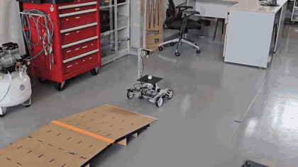
</p>

<p align="center"><a href="media/final_run.mp4">Full run (1 min 55 s)</a>: 3 × 0.75 m rectangle with turns in place and ramp passes at 0.2 m/s.</p>

---

## Why it is hard

On a fixed base, each axis of a ball-and-plate system is a double integrator driven by the plate angle:

$$\ddot x_b = \tfrac{5}{7}\,g\,\alpha, \qquad \ddot y_b = \tfrac{5}{7}\,g\,\beta .$$

On a moving base, the plate frame is no longer inertial. The ground slope $\gamma$, the base acceleration $\mathbf a_P$ and the yaw rate $\omega$ enter the ball dynamics with the same weight as the gravity term the controller uses to move the ball:

$$\ddot{\mathbf r} \approx \tfrac{5}{7}\big[\mathbf g_\parallel(\alpha,\beta,\gamma) - \mathbf a_{P,\parallel}\big] + \mathbf d_\omega(\mathbf r,\dot{\mathbf r},\omega,\dot\omega).$$

On top of this, the camera, the image processing and the servos add up to about **0.19 s of delay** (six frames at 30 Hz). The plate has no joint sensors.

## Results

| Test | Result |
|---|---|
| Base, 30 laps of a 1 m square | RMS tracking error: median **1.3 mm** (p90 6.3 mm) |
| Base, 92 straight 1 m segments | final error 0.1 mm |
| Plate IK vs. inclinometer, steps up to ±15° | median error **0.6°** (max 2.8°) |
| Ball, base at rest (LQR / PD / PPO) | median distance to centre **0.6** / 1.5 / 0.9 cm |
| Ball pushed 5–7 cm off centre (72 trials) | back in 0.4–0.5 s |
| Ball, rectangle with an ≈8.5° ramp, 4 trials | median 1.0–1.3 cm, max 7.0 cm, **no losses** |
| Perception on the robot | 29 FPS, ball seen in 100 % of the frames |

Base errors come from odometry, not from an external reference.

<p align="center">
  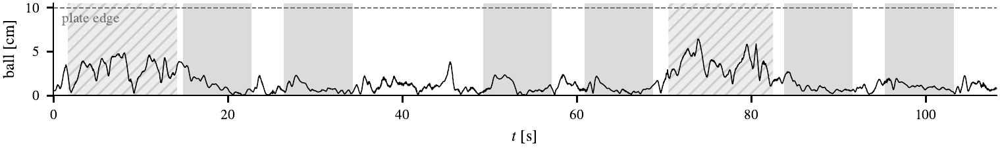
  <br><sub>Ball distance to the plate centre during the final run. Grey: turns in place; hatched: ramp passes.</sub>
</p>

<p align="center">
  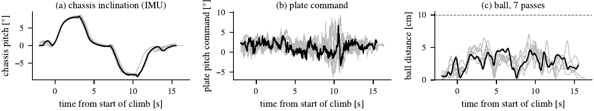
  <br><sub>Seven ramp passes aligned at the start of the climb (black: first pass of the final trial).</sub>
</p>

## Hardware

<p align="center">
  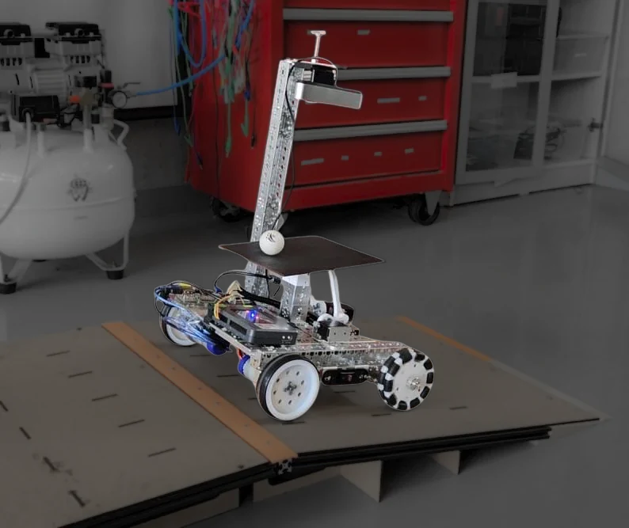
  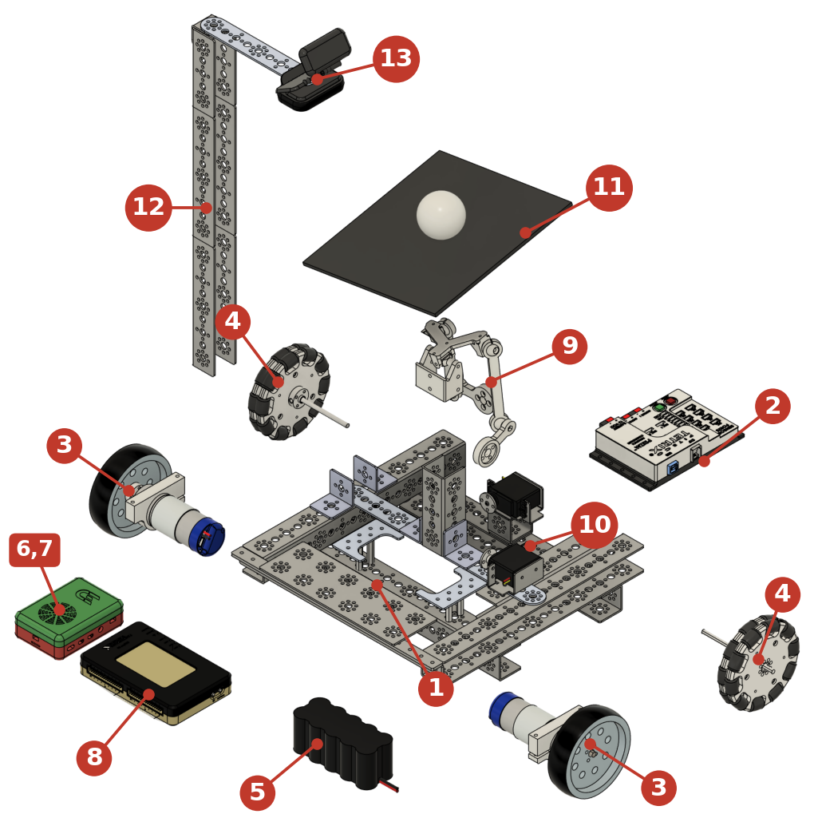
</p>

- **Base:** TETRIX MAX frame, two TorqueNADO gear motors (12 V, 60:1, 1440 counts/rev), two omni-wheels. Mass about 6 kg.
- **Plate:** 200 × 200 × 4 mm, centred on a universal joint. Two HS-485HB servos drive it through 35 mm cranks and 85 mm rods with printed ball joints (R–S–S chains at 45° from the cardan axes). The inverse kinematics is closed-form and runs on the PRIZM as a table. Working range ±15°.
- **Sensing:** USB camera on a mast (moves with the plate support, so the ball is measured directly in the plate frame) and an MPU6050 on the chassis.
- **Compute:** Raspberry Pi 3 B+ (vision + ball control), NI myRIO-1900 (odometry + trajectory), TETRIX PRIZM Pro / ESP32-S3 (wheel PI loops, plate IK, servo pulses).

<p align="center">
  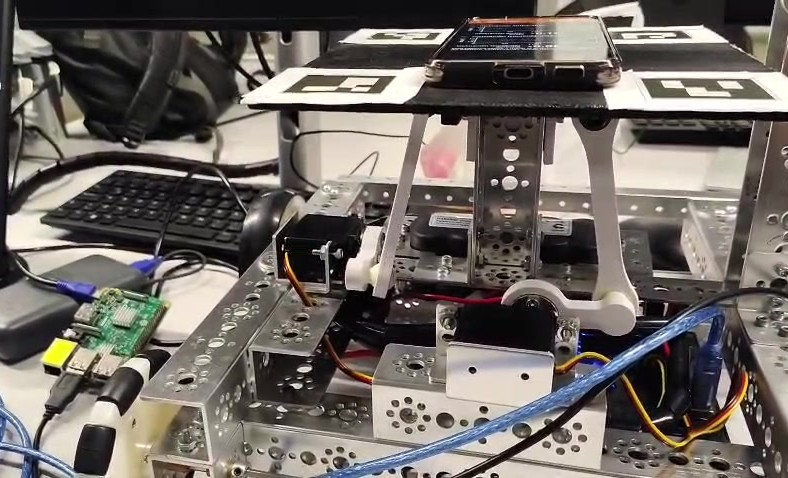
  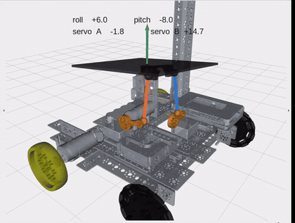
</p>

<p align="center">
  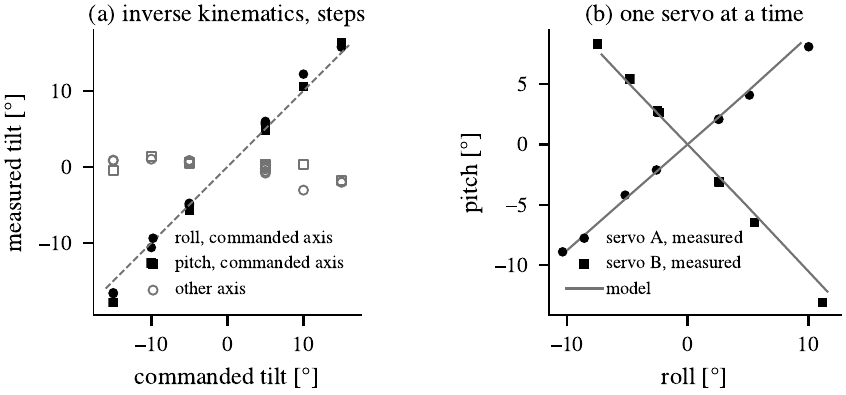
  <br><sub>Commanded vs. measured plate tilt. The error is set by the 1° resolution of the servo command.</sub>
</p>

<p align="center">
  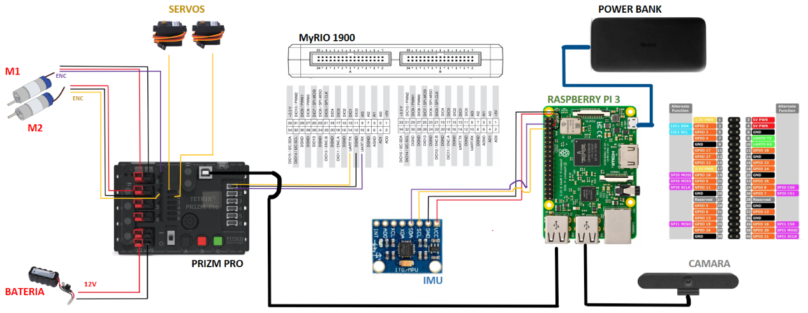
</p>

## Architecture

<p align="center">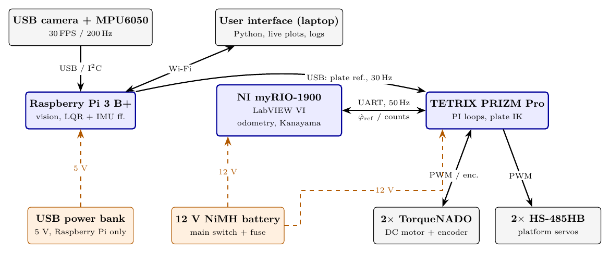</p>

Three processors, each with one job, connected by plain ASCII serial lines that can be read with any terminal:

| Link | Interface | Data | Rate |
|---|---|---|---|
| Camera → Pi | USB (UVC) | 640 × 480 video | 30 FPS |
| MPU6050 → Pi | I²C | acceleration, angular rate | 200 Hz |
| Pi → PRIZM | USB serial | plate reference (roll, pitch) | 30 Hz |
| myRIO ↔ PRIZM | UART (MXP B) | wheel-speed references / encoder increments | 50 Hz |
| Pi, PRIZM → laptop | Wi-Fi (UDP) | ball, plate, odometry, wheels, IMU | 30–50 Hz |

### Control

<p align="center">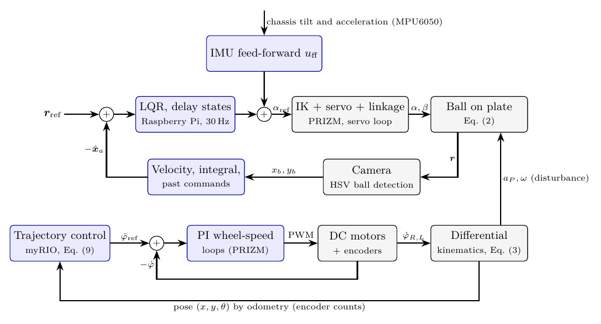</p>

- **Ball loop (Pi, 30 Hz).** Discrete LQR on the linear model. The 0.19 s delay is not handled with a predictor: it enters the model as a shift register of the last six commands, so the controller knows what the plate is about to do. The state is $\mathbf x_a=[x_b,\ \dot x_b,\ \int x_b,\ u_{k-1},\dots,u_{k-6}]$.
  Gains: $k_p=116.7$ °/m, $k_d=78.5$ °·s/m, $k_i=35.6$ °/(m·s), 0.224–0.296 on the past commands. Plate command limited to ±11° and 40 °/s.
- **IMU feed-forward.** $u_\text{ff}=\mathbf M(\Delta\mathbf g+\mathbf a/g)$ compensates the chassis tilt and acceleration, with $\mathbf M$ calibrated on the ramp.
- **Trajectory (myRIO, 50 Hz).** Odometry plus the Kanayama tracking law, gains set by a triple pole at −1 s⁻¹. When a wheel saturates, both references are scaled together so the path curvature is kept.
- **Wheels (PRIZM, 100 Hz).** One PI loop per wheel, tuned with SIMC from step tests, with anti-windup. A watchdog stops the wheels if the references stop arriving.

A PD loop and a PPO policy (also running in C, on the Pi or on board the ESP32) were kept for comparison.

<p align="center">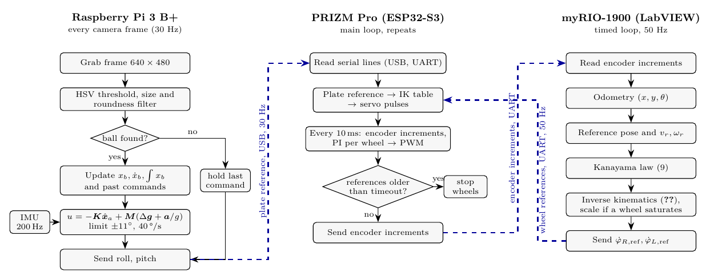</p>

### Perception

A white ball on a black plate, segmented with an HSV threshold and size and roundness filters (C++/OpenCV, about 18 ms per frame on the Pi 3). ArUco markers on the plate corners were tested as a plate pose sensor, but the final loop works without them.

<p align="center">
  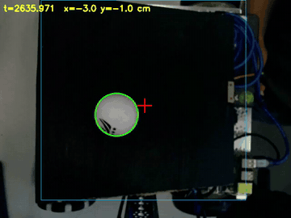
  <br><sub>On-board camera while the chassis is tilted by hand (LQR).</sub>
</p>

### Base

<p align="center">
  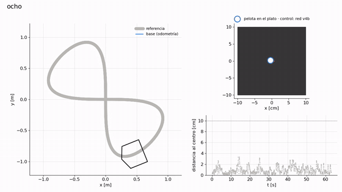
  <br><sub>Figure eight with the ball on the plate: path, ball on the plate and distance to the centre.</sub>
</p>

<p align="center">
  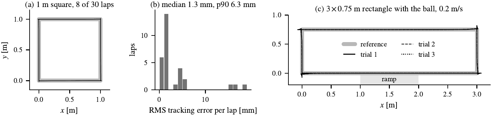
</p>

### Controllers compared with the base at rest

<p align="center">
  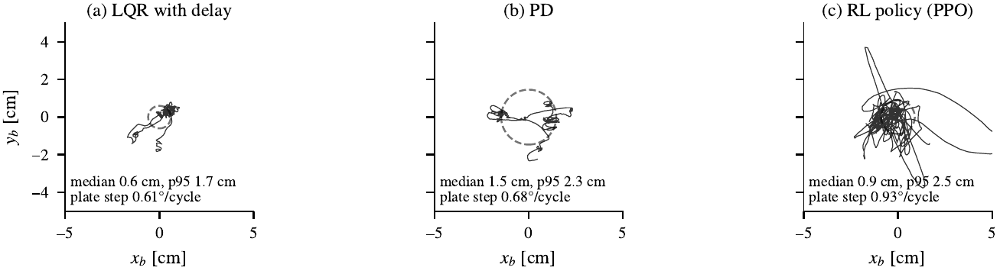
</p>

## Repository layout

```
firmware/gimbal_fw/     PRIZM Pro (ESP32-S3) firmware: wheel PI loops, plate IK table, serial protocol, watchdogs
  test/                 PC tests of the base kinematics, odometry EKF and IMU filter
raspberry_pi/           ball detection + LQR (ball_pixel.cpp), IMU reader (imu_pi.c), supervisor script
  config/               gains, IMU feed-forward matrix and start-up settings used in the final trials
  systemd/              user services that start everything at boot
gui/                    laptop interface and data logger (tkinter + matplotlib)
hardware/cad/plate/     printed plate mechanism: Python CAD sources, STEP, STL, closed-form IK and table
hardware/cad/common/    shared CAD helpers (ball joint, printing rules, kit dimensions)
media/                  videos, figures and diagrams used in this README
```

The myRIO trajectory VI (LabVIEW) lives in its own repository: [Ronaldgta/Proyecto_Tray_Odo-LabVIEW](https://github.com/Ronaldgta/Proyecto_Tray_Odo-LabVIEW).

Code comments are in Spanish.

## Build and run

**1. Mechanics.** Assemble the TETRIX frame with the drive wheels on a common axis. Print the plate parts in PETG from `hardware/cad/plate/stl/` (3.5 mm holes for M3, 0.25 mm radial clearance around the 14 mm balls). Fix the servos so the cranks are horizontal at the IK zero, and set the zero in software rather than by moving the horn.

**2. PRIZM firmware.** Arduino IDE with the ESP32-S3 core and the `TETRIX_PRIZM_PRO` library (v1.15). Open `firmware/gimbal_fw/gimbal_fw.ino` and flash. The serial protocol is documented at the top of that file. After power-up the PRIZM waits for its green button before arming the servos.

PC tests, no robot needed:

```bash
cd firmware/gimbal_fw/test
gcc -O2 -Wall -I.. -o /tmp/test_base_kin test_base_kin.c ../base_kin.c -lm && /tmp/test_base_kin
gcc -O2 -Wall -I.. -o /tmp/test_ekf test_ekf.c -lm && /tmp/test_ekf
gcc -O2 -Wall -I.. -o /tmp/test_imu test_imu.c -lm && /tmp/test_imu
```

**3. Raspberry Pi** (Raspberry Pi OS, OpenCV 4):

```bash
cd raspberry_pi
gcc -O2 -c policy.c && g++ -O2 -pthread -o ~/ball_pixel ball_pixel.cpp policy.o $(pkg-config --cflags --libs opencv4)
gcc -O2 -Wall -I. -o ~/imu_pi imu_pi.c -lm
cp arranque.sh config/* ~/
mkdir -p ~/.config/systemd/user && cp systemd/*.service ~/.config/systemd/user/
systemctl --user enable --now dsm-pelota imu-pi
~/imu_pi --nivel        # once, robot still on level ground: stores the IMU level reference
```

`pelota.conf` sets the brightness threshold of the ball (`VMIN`: about 90 under lamps, 140 in daylight). `pd_ganancias.txt` holds the LQR gains loaded at start-up. `imu-pi.service` assumes the user `robot`; edit its paths otherwise.

**4. myRIO.** Load the VI from the repository above. Use the same wheel radius and track width in the VI, the firmware and the interface ($r_w=51.4$ mm, $b=335$ mm, measured on the robot).

**5. Interface (laptop):**

```bash
pip install pyserial matplotlib
python3 gui/dsm_gui.py --pi <PI_IP>
```

Check that every link shows its nominal rate, place the ball near the centre, arm the plate, start the trajectory from the myRIO and press Record.

**CAD sources** use [build123d](https://github.com/gumyr/build123d). `kinematics.py` regenerates the IK table, so changing the crank or rod length updates the STEP files and the table together.

## Limitations

- Base acceleration is the largest disturbance: below 0.2 m/s² the ball was lost in about 1 % of the time windows, above 0.8 m/s² in about 9 %.
- The best controllers spent 41–48 % of the time at the plate limit, so the servos and linkage leave no margin for faster motion.
- Near the plate edge, glare or a bright background breaks the detection.
- The base pose comes only from the encoders. The 20° slope case was only checked by tilting the robot by hand (no ramp of that slope was available).

## Team

Frans Basilio, Caleb Churata, Ronald García, Jhosep Gutierrez. Department of Mechatronics Engineering, Universidad de Ingeniería y Tecnología (UTEC), Lima, Peru. MT5001 Mechatronic Systems Design, 2026.

UTEC provided the TETRIX kit, the myRIO, the PRIZM, the Raspberry Pi, the IMU and the camera, and printed the plate parts.

## License

Software: [MIT](LICENSE). Hardware (CAD in `hardware/`): [CERN-OHL-S v2](hardware/LICENSE).
